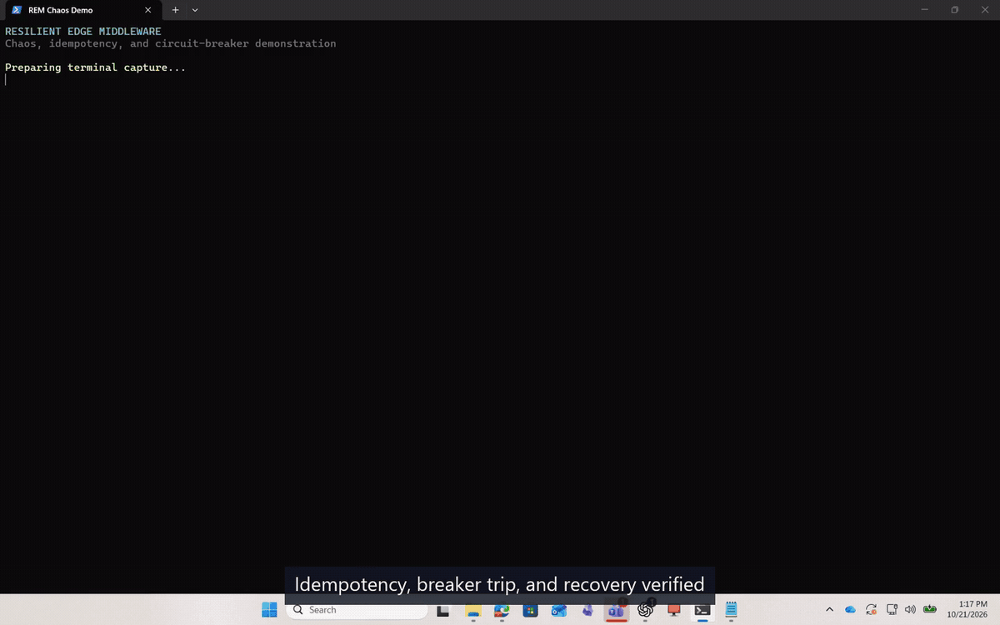
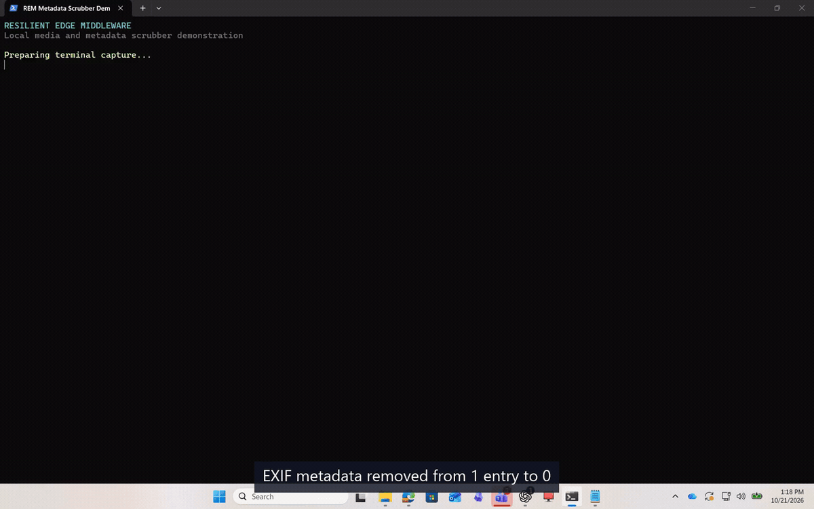

# Resilient Edge Middleware (REM)

[](https://github.com/rubenjohnmendoza-dev/resilient-edge-middleware/actions/workflows/ci.yml)

REM is a Cloudflare Worker for zero-trust order intake. It combines strict Zod
validation, idempotent request handling, a sliding-window circuit breaker, and
structured request tracing.

## Verified Results

- Unit tests: **31/31 passing**
- Worker bundle: **27.75 KiB gzip** from the Wrangler dry-run build
- Chaos test: **180-request mixed burst with zero unexpected 500 responses**
- Circuit breaker: 3 injected failures returned `503` with `Retry-After: 10`
- PocketBase: live integration verified against PocketBase `0.40.5`

See [resilient-edge-middleware.md](resilient-edge-middleware.md) for the full
evidence table. Docker Compose and Stirling-PDF are structurally verified; full
runtime execution remains pending a Docker-capable host.

## Demonstration

### Idempotency, circuit breaking, and recovery

[](./docs/media/rem-chaos-circuit-breaker.mp4)

[Open the full-quality MP4](./docs/media/rem-chaos-circuit-breaker.mp4)

This recording shows malformed input rejected with `400`, a valid order returning
`200`, the exact duplicate rejected with `409`, three injected failures opening
the circuit, normal traffic receiving `503` with `Retry-After: 10`, health
remaining available, and the cooldown probe closing the breaker after returning
`200`.

### Python metadata scrubbing

[](./docs/media/rem-metadata-scrubber.mp4)

[Open the full-quality MP4](./docs/media/rem-metadata-scrubber.mp4)

This recording creates a JPEG with an EXIF artist field, runs the local Python
scrubber, and verifies that the output is rebuilt with zero EXIF entries.

## Local Docker stack

The stack contains:

- `rem`: Wrangler dev server on port `8787`
- `pocketbase`: persistent PocketBase backend and admin UI on port `8090`
- `stirling-pdf`: local Stirling-PDF document utility on port `8080`
- `mock-webhook`: Node webhook receiver and API probe on port `8788`
- `chaos`: an on-demand chaos runner using `tests/chaos/chaos-injector.ts`

### Start the stack

From the repository root:

```bash
cd docker
docker compose up -d
```

The first run builds the REM image and starts REM, PocketBase, Stirling-PDF, and
the mock webhook. Use `docker compose up -d --build` after changing
dependencies, the Dockerfile, or the container command.

Check service state and wait for the REM health check:

```bash
docker compose ps
curl http://localhost:8787/health
```

Primary access ports:

| Service | URL |
| --- | --- |
| REM Worker | `http://localhost:8787` |
| PocketBase Admin | `http://localhost:8090/_/` |
| Stirling-PDF UI | `http://localhost:8080` |
| Mock webhook | `http://localhost:8788` |

### PocketBase persistence

On the first run, open PocketBase Admin and create a superuser. The Compose
defaults are:

```text
Email:    admin@rem.local
Password: rem-local-dev-password
```

Change these before starting the stack by setting
`POCKETBASE_ADMIN_EMAIL` and `POCKETBASE_ADMIN_PASSWORD`, then create the same
superuser in PocketBase. These defaults are for local development only.

The adapter authenticates lazily and creates these collections on first use:

- `idempotency_keys`
- `request_audit_logs`
- `telemetry_metrics`

Idempotency hashes, span metrics, and request audit records are then stored in
the `pocketbase_data` volume and survive Worker restarts. If PocketBase is
unavailable or not yet configured, idempotency falls back to the isolate-local
memory store and telemetry continues to stdout.

### Submit an order

```bash
curl -X POST http://localhost:8787/orders \
  -H "content-type: application/json" \
  -d '{
    "id": "550e8400-e29b-41d4-a716-446655440000",
    "amount": 42.5,
    "currency": "AUD",
    "customerEmail": "customer@example.com",
    "timestamp": "2026-10-20T01:20:00.000Z"
  }'
```

The first request returns `200`. Sending the exact same body again within the
24-hour idempotency window returns `409` with `DUPLICATE_REQUEST`. When
PocketBase is configured, that reservation is persisted in PocketBase.

### Exercise the mock webhook

```bash
curl -X POST http://localhost:8788/webhook \
  -H "content-type: application/json" \
  -d '{"event":"order.created","id":"demo-001"}'

curl http://localhost:8788/last
```

The webhook returns `202` and acknowledges receipt. `/last` returns the most
recently received payload.

## Chaos testing

Run the chaos suite against the local stack:

```bash
cd docker
docker compose --profile chaos run --rm --build chaos
```

The injector:

- Resets local idempotency and circuit-breaker state.
- Sends randomized malformed JSON and schema-invalid payloads, asserting `400`.
- Sends a valid payload twice, asserting `200` then `409 DUPLICATE_REQUEST`.
- Floods the service with concurrent mixed traffic, asserting only `200`, `400`,
  `409`, or `503` responses and no `INTERNAL_ERROR`.
- Checks `/health` after the spike.
- Injects three simulated downstream failures through `x-chaos-fail: 1`, then
  asserts a normal request receives `503 CIRCUIT_OPEN` with `Retry-After`.
- Checks that the Worker remains healthy while the circuit is open.
- Resets state after the suite so the dev stack remains usable.

Optional load controls:

```bash
CHAOS_SPIKE_REQUESTS=20 CHAOS_BURSTS=2 \
  docker compose --profile chaos run --rm chaos
```

The supported variables are `CHAOS_SEED`, `CHAOS_SPIKE_REQUESTS`, and
`CHAOS_BURSTS`. The default run uses 60 concurrent requests per burst, three
bursts, and seed `20261020`.

## Local-only chaos hooks

The Compose service starts Wrangler with `CHAOS_MODE=true`. This enables:

- `POST /_chaos/reset`: clears persisted or in-memory idempotency state and
  closes the circuit breaker.
- `x-chaos-fail: 1` on `POST /orders`: returns `503 CHAOS_FAILURE` and records a
  breaker failure.

These hooks exist only for local chaos testing and must not be enabled in
production.

## Dual-layer data hygiene

REM separates text hygiene from binary media hygiene.

### Layer A: edge text sanitization

`src/middleware/sanitize.ts` recursively sanitizes JSON keys, strings, arrays,
and nested objects. It removes Unicode format controls, including zero-width
characters, bidi marks, BOM/word joiners, soft hyphens, and the
U+E0000-U+E007F tag block. It also removes invisible C0/C1 controls, applies
Unicode NFC normalization, and trims leading/trailing whitespace.

The Worker calls `sanitizePayload` after `JSON.parse` and before Zod validation.
Genuinely invalid data is still rejected, while clean payloads pass through
semantically unchanged. Removing zero-width joiners intentionally changes
emoji sequences that rely on them.

### Layer C: media metadata scrubber

`service/scrub_media.py` handles PNG, JPEG, and PDF files that should not be
processed inside the edge Worker:

- Images are decoded, orientation-corrected, and re-encoded through Pillow
  without EXIF, XMP, ICC, comments, PNG text chunks, or ancillary credential
  metadata. This also removes C2PA/JUMBF APP/ancillary segments.
- PDFs are rebuilt through pikepdf with document info, XMP `/Metadata`,
  `/PieceInfo`, `/AF` associated files, and `/Names/EmbeddedFiles` attachments
  removed.
- Every output is reopened and verified for the targeted metadata before the
  request returns.

This is structural metadata and credential hygiene. It does not attempt
statistical or model-specific watermark removal, and image re-encoding changes
the file bytes.

Install and run the scrubber:

```bash
python -m venv .venv
```

PowerShell:

```powershell
.venv\Scripts\Activate.ps1
pip install -r service/requirements.txt
uvicorn service.scrub_media:app --host 127.0.0.1 --port 8091
```

macOS/Linux:

```bash
source .venv/bin/activate
pip install -r service/requirements.txt
uvicorn service.scrub_media:app --host 127.0.0.1 --port 8091
```

Upload a file for scrubbing:

```bash
curl -F "file=@input.jpg" \
  http://127.0.0.1:8091/scrub/upload \
  -o scrubbed.jpg
```

Scrub a path available to the local service:

```bash
curl -X POST http://127.0.0.1:8091/scrub \
  -H "content-type: application/json" \
  -d '{"path":"input.png"}'
```

Path access is constrained to `REM_SCRUB_ROOT`, which defaults to the process
working directory. Output defaults to `scrubbed/<filename>`. Uploads are limited
to 50 MB by default; override with `REM_MAX_UPLOAD_BYTES`.

The same scrubbing engine is available from the CLI:

```bash
python service/scrub_media.py input.png input.pdf --output-dir scrubbed
```

The edge Worker handles JSON text; local automation or a trusted backend handles
binary attachments by calling the media service and receiving scrubbed bytes.
The Python service is deliberately separate from the Worker so PDF/image
parsing and native libraries do not run in the edge runtime.

## Unit tests and type checking

On the host:

```bash
pnpm install
pnpm typecheck
pnpm test
```

Inside the built container:

```bash
docker compose run --rm --no-deps rem pnpm typecheck
docker compose run --rm --no-deps rem pnpm test
```

## Shutdown

```bash
cd docker
docker compose down -v
```

With PocketBase running, idempotency reservations and telemetry writes are
persistent. The circuit breaker remains isolate-local, and PocketBase write
failures fall back to the in-memory idempotency store for local availability.
Use `docker compose down` to stop services while retaining `pocketbase_data`, or
`docker compose down -v` to remove the volume and all stored records.
